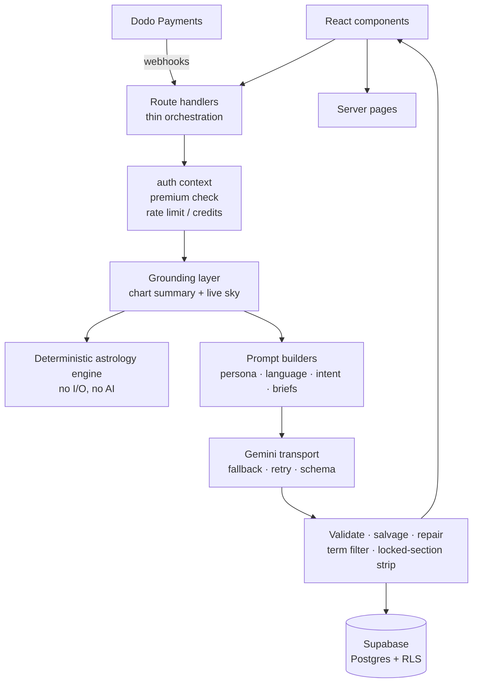
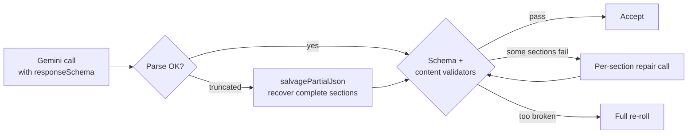

# Astraten AI — AI Engineering Showcase

> A production, Georgian-first AI astrology app. A user enters birth data once; every AI feature after that is **grounded in a deterministically computed natal chart and the live sky**. The LLM writes the words. It never decides the facts.

**This repository is a showcase only.** It documents the AI engineering, architecture and product decisions behind Astraten AI. The application source is private.

**Built with:** Next.js 16 · React 19 · TypeScript · Supabase · Google Gemini (raw REST, no SDK) · Dodo Payments · Vercel

---

## Table of contents

1. [AI engineering highlights](#ai-engineering-highlights)
2. [What the product does](#what-the-product-does)
3. [System architecture](#system-architecture)
4. [Grounding: the LLM never invents the facts](#grounding-the-llm-never-invents-the-facts)
5. [LLM transport and reliability](#llm-transport-and-reliability)
6. [Structured output, validation and self-repair](#structured-output-validation-and-self-repair)
7. [Prompt engineering](#prompt-engineering)
8. [Multilingual AI: Georgian as a low-resource language](#multilingual-ai-georgian-as-a-low-resource-language)
9. [Fighting generic output: the "meaning engine"](#fighting-generic-output-the-meaning-engine)
10. [Streaming chat, intent routing and the teaser paywall](#streaming-chat-intent-routing-and-the-teaser-paywall)
11. [Cost, limits and abuse control](#cost-limits-and-abuse-control)
12. [Evaluation and testing of AI behavior](#evaluation-and-testing-of-ai-behavior)
13. [AI-assisted development workflow](#ai-assisted-development-workflow)
14. [Deterministic astrology engine](#deterministic-astrology-engine)
15. [Billing, data model and security](#billing-data-model-and-security)
16. [Lessons learned and trade-offs](#lessons-learned-and-trade-offs)

---

## AI engineering highlights

| Area | What I built |
|---|---|
| **Grounded generation** | All astrology (positions, aspects, transits, scores) is computed in code. The model receives facts and writes prose around them, so a report cannot contradict its own score. |
| **Reliability** | Multi-model fallback chain, bounded retries on overload, schema-constrained JSON, truncated-JSON salvage, and a **targeted per-section repair loop** (about 70% cheaper than a full retry). |
| **Structured output** | Gemini `responseSchema` with per-field length caps, plus server-side validation (`matchesSchema`) and content validators that reject banned phrases and source lifting. |
| **Prompt architecture** | Prompts are assembled from composable parts: persona, language rules, safety rules, intent recipes, section briefs, data whitelists. They are treated as product code, not strings. |
| **Low-resource language** | Georgian-first. Grammar coaching blocks, a declined zodiac-name table with a post-generation filter that repairs transliterated names while preserving grammatical case, and language-aware token budgets. |
| **Anti-generic output** | A "meaning engine" design: seeded selection of real material, sentence *shapes* instead of topics, idea-level repetition memory, measured imagery balance. |
| **Streaming + monetization** | SSE chat with regex intent routing, a crisis-safe-guard rule, and a **server-side teaser** that withholds the paid answer from the client entirely. |
| **Cost control** | Token caps tuned per language and tier, daily cache of an expensive computation, prompt slimming per tier, per-user and per-IP limits, charge-on-success credits. |
| **Evaluation** | Runnable harnesses that call the real model and measure repetition, shape, imagery concentration and failure-path behavior, plus deterministic unit tests for the math. |
| **AI-assisted dev** | An agent guide, hard rules and per-folder READMEs written so coding agents can work in the repo safely. |

## What the product does

Astraten AI is a consumer astrology product for the Georgian market, with English and Spanish also supported. It speaks as **Natia**, a warm, direct astrologer persona rather than a generic horoscope generator.

| Feature | Description |
|---|---|
| **AI chat with Natia** | Streaming conversation that sees the person's chart and the current sky. |
| **Compatibility** | Deterministic score and radar, plus an AI report written *around* those numbers. |
| **Week forecast & career reading** | Structured readings with free and premium sections. |
| **Specialty readings** | Natal blueprint, past-life reading, "Zodiac Man" body map, week-in-review. |
| **Social layer** | Friends, public profiles, weekly leaderboard, shared week board. |
| **Reading history, referrals, credits** | Auto-saved results; invite-to-earn credits that unlock full readings. |

## System architecture

One Next.js app serves the website and the JSON API. Dependencies point **downward only**; `lib/` never imports from `app/` or `components/`.



Every AI feature follows one pipeline, differing only in prompt and delivery:

```
auth → premium → limit / credit check → load chart
  → ground (chart summary + live sky) → build prompt
  → Gemini (fallback + retry) → parse → validate → salvage / repair
  → strip locked sections by entitlement → persist → respond
```

Route handlers stay thin on purpose: parse with zod, authenticate, load rows, call `lib/`, return a typed response. All business logic lives in testable modules.

## Grounding: the LLM never invents the facts

The central design decision: **the model is a writer, not an astrologer.**

- Planet positions, houses, ascendant, aspects, retrogrades, void-of-course moons and upcoming transits are computed locally with `astronomy-engine` and `circular-natal-horoscope-js`. There is no third-party astrology API and no LLM guesswork about the sky.
- Compatibility scoring is deterministic. The prompt receives the precomputed score and level, with tone instructions pegged to that score, so the prose cannot drift from the number shown in the UI.
- Prompts include per-section **data-source whitelists**. Each section may only draw on the facts it is given.
- Technical astrology is translated into plain phrases *before* the model sees it. An audit of generated Georgian forecasts found a technical term repeated 13 times across 5 readings, because the model mirrors its input. The fix was to change the input vocabulary, not to add another instruction.
- Chat prompts get the chart signals compactly, and the full chart JSON on the first message only, to save tokens.

## LLM transport and reliability

A single module owns every Gemini call. Routes never `fetch` the model directly.

- **Raw REST, no SDK.** Fewer dependencies and full control over retry, schema and streaming behavior.
- **Model fallback chain.** Several Gemini models are tried in order. Each gets bounded retries with a pause on overload (503/429). Other errors skip straight to the next model. Callers always receive a normal response and handle failure themselves.
- **Uniform generation config** with thinking disabled and explicit `maxOutputTokens` per feature.
- **Failure-aware economics.** Credits are charged only after a successful generation. On AI overload the API returns a "credits kept" flag so the UI can reassure the user.

## Structured output, validation and self-repair

Reports are generated as JSON under a **response schema** with per-field `maxLength`, item counts and required keys. Constrained decoding is then backed by server-side checks.



- **Salvage.** If the output is cut off mid-JSON, the completed sections are recovered instead of discarded.
- **Content validators.** Beyond schema shape, sections are rejected for banned "safe" filler phrases, reassurance closers, and lifting phrases verbatim from the source material.
- **Per-section repair.** Only the failing sections are regenerated. Each section brief is self-contained, so a repair prompt is about 1,100 tokens against about 4,500 for a full retry, a saving of roughly 70% per failure.
- **Repair prompts carry two things a first attempt does not:**
  1. *Why it failed.* A blind re-ask reproduces the same mistake. Measured: a section lifted its source across four generations under four different wordings. Naming the offending phrase costs about 30 tokens and fixes it first time.
  2. *What the other sections already say*, truncated and passed as ground to avoid, so a section regenerated in isolation does not duplicate its neighbours.
- Cheaper repair made a stricter rule affordable. A rule that had been rejected because enforcing it meant paying for a full retry became worth enforcing.

## Prompt engineering

Prompts are composable builders rather than monolithic strings:

- **Chat system prompt** layers: persona → language rules → crisis rule → priority order → intent recipe → style rules → chart signals and live sky → optional compatibility mode → optional teaser instruction.
- **Crisis handling.** The safety rule triggers only on real signals of self-harm, in three languages. Ordinary emotional pain gets a warm astrological reply, not a hotline reflex.
- **Style contracts the UI depends on.** For example, bold text is permitted only around placements because the UI colors those spans.
- **Section briefs.** The compatibility report is split into small self-contained briefs (the pull, the mechanics, what it looks like between them, the chemistry line). Each owns its sample material, sentence shape and rules, which is what makes per-section repair possible.
- **Merged schema.** An earlier 21-field "form" repeated one idea in three boxes. Merging to a handful of longer sections removed the repetition at the same token cap.
- **Neutral voice.** Users do not reliably mark which profile is themselves, so reports address both people by name rather than risk "you" landing on the wrong person.
- **Tone rules for sensitive domains.** The body-map reading frames everything as historical tradition, bans clinical vocabulary, and pairs every sensitivity with a strength.

## Multilingual AI: Georgian as a low-resource language

Georgian is a hard case for LLMs, so it is first-class here:

- **Grammar coaching blocks** (ergative case, polypersonal agreement, avoiding calques) in two sizes: full for JSON reports, compact for chat.
- **Pluggable language rules.** Only languages that need coaching have entries. An absent entry means the model handles that language natively. Adding a struggling language is a data change.
- **Post-generation term filter.** The model sometimes writes the *sound* of an English zodiac name instead of the real Georgian one. A safety net rewrites these using declined forms, preserving grammatical case (genitive stays genitive). Ambiguous stems that double as common names are rewritten only when an astrological word follows. It only touches Georgian script, so it is a no-op on English or raw JSON.
- **Token economics.** Georgian tokenizes about 2–3× heavier than English, so output caps are language-aware.
- **One translation source of truth** for signs, planets and elements, enforced by a repo rule.
- **Locale registry.** Languages are declared once and routing, validation, sitemap and AI handling derive from it.

## Fighting generic output: the "meaning engine"

LLMs sample the middle of everything they have read, which is the definition of generic. The design response is to stop asking the model to supply the feeling.

- **Sentence machines.** Give the model a sentence *shape* plus real examples and it fills it reliably. Give it only a topic and it writes poetry that means nothing.
- **Pick before writing.** Hand the model specific material rather than suppressing its defaults afterwards.
- **Seeded selection.** Material is chosen from curated banks using a seed derived from the user, chart, week and event, so output is varied across people and stable for the same input.
- **Idea memory.** Remember the thought used last time, not the wording, and forbid it.
- **Bank-depth math.** Bank size divided by usage frequency sets the best achievable gap between repeats. No cooldown setting beats it.
- **Truth vs. richness.** Emotional language makes claims the sky cannot support, but hedged language is the average-model voice. The resolution: describe *what the sky was asking* in concrete terms and let the reader supply the memory.
- **Constraint inversion.** Unlike a free-topic content generator, the topic here is forced by real transits. Variety must come from depth per event type, and "nothing notable happened" is treated as a first-class path.
- **Reconciling three scorers.** Daily-card, life-area and weekly-recap logic had different orbs and targets and could disagree on one screen. The design plan unifies them.

## Streaming chat, intent routing and the teaser paywall

- **SSE streaming** straight through to the browser. The user message is persisted *before* streaming so it survives disconnects.
- **Intent detection.** A multilingual keyword classifier routes each question to one of six intents (weekly, event, relationship, emotional, recurring, general), each with its own reply recipe.
- **Session management.** Server-side overflow pruning keeps the oldest-session cap per tier.
- **Teaser mode.** On a free user's last daily message the server buffers the reply instead of streaming, splits it into hook and payoff (with a fallback split if the model ignores the delimiter), sends **only the hook** with a lock header, and stores both. The paid text never reaches an unentitled browser.
- **Server-side paywall for JSON readings.** The model generates free and locked sections together; the server deletes the locked part before responding.

## Cost, limits and abuse control

- **Token budgets** are tuned per language and per tier. Georgian caps were raised after replies truncated.
- **Prompt slimming.** The free tier omits data it is forbidden to use (for example, it drops the zodiac-name table when sections may not name astrology).
- **Daily cache.** The 60-day upcoming-transit scan depends only on the date, so it is computed once per UTC day (lazy fill plus a cron warmer) and shared by all requests. Hour-sensitive moon data stays live.
- **Ledger-based rate limits.** A passed check also records the usage row. Free users face an additional per-IP cap at five times the free limit to deter account farming.
- **Per-feature, per-tier quotas** across chat, forecasts, compatibility and specialty readings.

## Evaluation and testing of AI behavior

There is no unit-test framework. Instead, the repo has purpose-built harnesses for LLM behavior:

| Harness | What it measures |
|---|---|
| Compatibility run + sweep | Runs a generated line across many fixture couples and measures **pairwise content-word overlap**, shared phrases, **sentence shape** (a machine bounded too tightly produces lines that differ in content and are identical in construction), and material **echoed back verbatim**. |
| Behaviour-bank audit | Offline, zero tokens. Classifies imagery by domain to catch concentration. Written in one sitting, the bank came out 16.7% food and kitchen, which produced lines that read like restaurant reviews. Also checks depth: at four entries per sign, couples sharing a sign collided at 0.415 overlap. |
| Repair-path test | Deliberately starves the output cap to force truncation, then exercises the real salvage and repair functions. A failure is a failure in the real request path, not a stand-in. |
| Live prompt harnesses | Run chat, forecast, week-review and natal-blueprint prompts against the real model in seconds. |
| Pure unit tests | Deterministic checks for life-area scoring, synastry (including **order-symmetry** and range), and locale completeness. They exit non-zero on failure. |

Lesson encoded in the docs: *a plan that disagrees with the code is worse than no plan.* Planning documents carry "last verified" dates, and the rule is that the code wins.

## AI-assisted development workflow

The repo is structured so coding agents can work in it safely:

- An **agent guide** with a task router, a "read this first" table and non-negotiable rules.
- A **rules document** with explicit do/don't lists: shared layers are the only way to do cross-cutting things, prompt wording is protected, and no gate may be weakened for convenience.
- A **README in every code folder** describing mechanism, plus a navigation index. New folders require one.
- A working-method document, a definition of done (typecheck, lint, build), and a rule that the code is the source of truth over memory.
- A **dated schema-snapshot warning**, so agents do not invent columns.
- Early prototypes used OpenAI before the migration to Gemini; the harness scripts mark which are legacy.

## Deterministic astrology engine

All astrology lives in a pure layer with no I/O, which can be reasoned about and tested without any environment.

| Capability | Approach |
|---|---|
| Natal chart | Tropical, Placidus. Falls back to a date-only sun-sign chart on any failure. |
| Live sky | Moon phase and sign, retrogrades, void-of-course periods, upcoming transits, and one pre-filtered "foreshadow" line per prompt. |
| Compatibility score | Element and modality scorer, 0–100, with a five-factor breakdown. |
| Synastry radar | Aspect-based, five dimensions, **order-symmetric**, and comparable across couples via fixed reference values instead of per-couple normalization. |
| Life-area scoring | Five life areas scored 0–100 around a neutral 50, with orb falloff, per-aspect valence and retrograde dampening. |
| Shared aspect core | One module serves transit-to-natal and natal-to-natal scoring so they cannot drift apart. |

## Billing, data model and security

- **Premium gating** goes through one `isPremium()` function, with a grace window for late renewal webhooks and a hard cutoff for scheduled cancellations.
- **Dodo Payments webhook** is the single writer of subscription state. It verifies signatures and claims idempotency by inserting the event id as a primary key; duplicates are acknowledged as no-ops and failures release the claim so retries work.
- **Supabase** with Row Level Security. Queries are scoped by user id at both the application and database layers. A service-role client is confined to webhooks and referral jobs.
- **zod** validation on every request body; cron endpoints protected by a bearer secret.
- **Session refresh in the proxy layer**, because server components cannot persist rotated refresh tokens. This prevents random logouts.
- Content moderation helpers for display names and report reasons.

## Lessons learned and trade-offs

- **Changing the input beat adding instructions.** Fixing the model's echo of technical vocabulary worked by changing the vocabulary it was fed.
- **Measure, don't assume.** Imagery concentration, repetition and lifting were found with harnesses, not by reading outputs.
- **Targeted repair beats retry** once the failure reason can be passed back in.
- **Constrained decoding is not enough.** Schema validity does not guarantee content quality, so content validators sit on top.
- **Known debt, documented openly:** credit spending is read-then-write rather than the atomic database function that already exists; the Chinese zodiac is simplified; the "meaning engine" is partly planned and partly built.

---

## Contact

Built by **Guja Tsitaishvili**. Reach out via GitHub for a demo or technical walkthrough.
