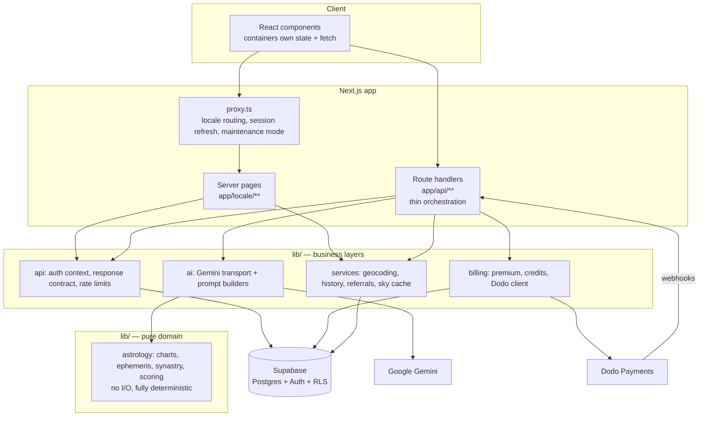

# Astraten AI — Technical Showcase

> A Georgian-first AI astrology app. Users enter their birth data once; every feature after that is personalized to their computed natal chart: an AI astrologer persona (**Natia**), compatibility reports, weekly and career forecasts, and more.

**This repository is a showcase only.** It documents the product, architecture and engineering decisions behind Astraten AI. The application source is private.

---

## Table of contents

1. [What it does](#what-it-does)
2. [Tech stack](#tech-stack)
3. [Architecture](#architecture)
4. [Key engineering decisions](#key-engineering-decisions)
5. [AI generation pipeline](#ai-generation-pipeline)
6. [Deterministic astrology engine](#deterministic-astrology-engine)
7. [Monetization and server-side paywalls](#monetization-and-server-side-paywalls)
8. [Billing and webhooks](#billing-and-webhooks)
9. [Internationalization](#internationalization)
10. [Data model](#data-model)
11. [Security](#security)
12. [Testing and tooling](#testing-and-tooling)
13. [Roadmap and known trade-offs](#roadmap-and-known-trade-offs)

---

## What it does

Astraten AI is a consumer astrology product built for the Georgian market first, with English and Spanish also supported. It does not generate generic horoscopes. It computes a real natal chart from the user's birth date, time and place, then grounds every AI response in that chart and in the live sky.

| Feature | Description |
|---|---|
| **Birth profiles & natal chart** | Interactive chart wheel. Users can track themselves plus friends, partners and family. |
| **AI chat with Natia** | Streaming conversation with an astrologer persona. It sees the person's chart and the current sky. |
| **Compatibility** | A deterministic score and radar, plus an AI-written report built around those numbers. |
| **Week forecast & career reading** | Structured JSON readings with free and premium sections. |
| **Specialty readings** | Natal blueprint, past-life reading, "Zodiac Man" body map, week-in-review. |
| **Social layer** | Friends, public profiles, weekly leaderboard, shared week board. |
| **Reading history** | Results are auto-saved and replayed through the same components that rendered them. |
| **Referrals & credits** | Invite friends to earn credits that unlock full readings. |

## Tech stack

| Layer | Technology |
|---|---|
| Framework | **Next.js 16** (App Router, Turbopack), **React 19**, **TypeScript** |
| Styling | **Tailwind CSS 4** |
| Database & auth | **Supabase** (Postgres, Auth, Row Level Security) |
| AI | **Google Gemini**, called over plain `fetch` with a multi-model fallback chain |
| Astronomy | `astronomy-engine`, `circular-natal-horoscope-js` (computed in-process) |
| Payments | **Dodo Payments** (subscriptions, one-time credits, customer portal, webhooks) |
| i18n | **next-intl** |
| Validation | **zod** on every POST route |
| Hosting | **Vercel**, with cron jobs |

## Architecture

One Next.js app serves both the website and the JSON API. Dependencies point **downward only**. `lib/` never imports from `app/` or `components/`.



**Route handlers are deliberately thin.** A typical route follows one shape: parse the body with zod, resolve the auth context, load rows, call a `lib/` function, return a typed `jsonOk` or `jsonError`. Business logic lives in `lib/`, where it can be reasoned about and tested without HTTP.

### Request lifecycle

1. `proxy.ts` runs first. It honors a `MAINTENANCE_MODE` flag, resolves the locale and refreshes the Supabase session.
2. Server pages fetch the user's rows directly through the cookie-based Supabase client and pass plain props to client components.
3. Client components call `/api/*` with `fetch`. Auth rides on HttpOnly cookies, so no tokens are held in JavaScript.

## Key engineering decisions

- **AI is not the source of truth for astrology.** Positions, aspects, scores and transits are computed deterministically in-process. The model only *writes about* numbers it is handed. A compatibility report cannot contradict its own score.
- **Paywalls are enforced on the server.** The AI generates free and locked sections together. The server strips the locked part before the response leaves for non-entitled users, so the paywall cannot be bypassed from the browser.
- **Single writer for subscription state.** Only the webhook writes billing state. Every other route reads it through one `isPremium()` function.
- **Credits are charged only on success.** A failed or overloaded AI call never costs the user anything.
- **Expensive work is cached once.** The 60-day upcoming-transit scan depends only on the date, so it is computed once per UTC day and shared by every request.
- **No AI SDK.** A single module owns model choice, retry policy and generation config, which makes behavior easy to audit and change.

## AI generation pipeline

Every AI feature shares the same shape and differs only in prompt and delivery:

```
auth → premium check → limit / credit check → load chart rows
  → build chart summary → build prompt → call Gemini
  → parse / stream → persist side effects → respond
```

**Resilient transport.** Models are tried in a fixed fallback order. Each model gets a bounded retry on overload (HTTP 503/429) and is skipped on other errors. Callers always receive a normal response object and handle failure themselves, so a provider outage degrades gracefully instead of breaking the page.

**Two delivery modes:**

- **JSON features** (forecasts, compatibility): the prompt demands structured output with `free` and `locked` sections, which the server validates and then strips by entitlement.
- **Streaming chat** (SSE): tokens flow straight to the browser. The user's message is persisted *before* streaming starts, so it survives a dropped connection.

**Prompt assembly for chat** layers: persona, language rules, safety rules, **intent detection** (the question is classified into weekly, event, relationship, emotional, recurring or general, each with its own reply recipe), style rules, the person's chart signals, and the live sky.

**Teaser mode (conversion design).** On a free user's last daily message, the server buffers the reply instead of streaming. It sends only the emotional hook to the client, with a lock header, and stores the withheld "payoff" server-side. Upgrading reveals the stored text. The full answer is never sent to the browser until the user is entitled.

## Deterministic astrology engine

All astrological math lives in a pure layer with no I/O, so it can be tested without any environment.

| Capability | Approach |
|---|---|
| Natal chart | Birth date, time and geocoded place go through `circular-natal-horoscope-js` (tropical, Placidus). The chart includes planets, houses, ascendant and midheaven. Any failure falls back to a date-only sun-sign chart. |
| Live sky | `astronomy-engine` computes moon phase and sign, retrogrades, void-of-course periods and upcoming transits. There is no third-party transit API. |
| Compatibility score | An element and modality scorer produces a 0–100 score with a five-factor breakdown. |
| Compatibility radar | An aspect-based synastry scorer rates five dimensions (romance, passion, values, growth, harmony). It is order-symmetric, so `score(A,B) = score(B,A)`, and comparable across couples through fixed reference values instead of per-couple normalization. |
| Life-area scoring | A natal chart plus daily transits scores love, career, health, money and communication from 0–100. It uses orb falloff, per-aspect valence and retrograde dampening, and degrades gracefully when house data is missing. |
| Shared aspect core | One aspect-scoring module serves both transit-to-natal and natal-to-natal features, so the two cannot drift apart. |

## Monetization and server-side paywalls

Three independent gates compose on every AI route:

1. **Premium status.** One function, `isPremium()`, is the only legitimate check. It prefers subscription status and period-end dates over a legacy boolean. It includes a short grace window for late renewal webhooks and a hard cutoff for scheduled cancellations.
2. **Rate limits.** Usage is counted per user, feature and period in a ledger table. The check that passes also records the consumption. Free users additionally face a per-IP cap against account farming.
3. **Credits.** Referral credits are spent before purchased ones. A credit is deducted only after generation succeeds.

| | Free | Premium |
|---|---|---|
| Birth profiles | self + 2 | self + 30 |
| Chat | 3 messages/day | 10 messages/day |
| Compatibility report | 2/week, free sections | 5/day, full |
| Forecasts | credits only | 3/day |

## Billing and webhooks

Billing runs on Dodo Payments with a webhook as the **single writer** of subscription state:

- **Checkout** creates a hosted session and attaches the user id as metadata.
- **Webhook** verifies the signature, then claims idempotency by inserting the event id as a primary key. A duplicate delivery hits a conflict and is acknowledged as a no-op. If processing fails, the claim is released so the provider's retry can succeed.
- **Cancellation** schedules the change for period end and keeps access until then.
- **Customer portal** hands off to the provider's hosted page.

## Internationalization

Georgian is the default locale. It is a low-resource language for LLMs, so Georgian-specific prompt handling is part of the product: grammar guidance to avoid calques, larger token budgets (Georgian tokenizes roughly 3× heavier than English), and a single source of truth for sign and planet translations.

A central locale registry is the only place a language is declared. Routing, the language switcher, static params, sitemap and hreflang tags, request validation and AI language handling all derive from it. Adding a market is data, not a code change.

Supported: **Georgian (default), English, Spanish.**

## Data model

Supabase Postgres with Row Level Security. Nearly all queries run as the signed-in user. A separate service-role client handles the few jobs that must cross user boundaries, such as webhooks and referral rewards.

| Table | Purpose |
|---|---|
| `profiles` | Account and billing state, credits, referral code |
| `birth_profiles` | People a user tracks. A partial unique index enforces a single "self" profile. |
| `chart_calculations` | Computed charts stored as JSONB. Readers take the newest row. |
| `chat_sessions`, `chat_messages` | Conversations, including withheld teaser payoffs |
| `ai_usage_logs` | The rate-limit ledger |
| `reading_history` | Auto-saved results with a 24-hour TTL |
| `sky_events_cache` | Daily cache of the expensive transit scan |
| `webhook_events` | Idempotency claims for payment webhooks |
| Social tables | Friendships, public profiles, leaderboard snapshots, week board |

The schema evolves through dated SQL migrations.

## Security

- Row Level Security on user data, with the service-role client confined to server-only jobs.
- Locked content never leaves the server for non-entitled users.
- Signature-verified, idempotent payment webhooks.
- zod validation on every request body.
- Per-user and per-IP rate limiting.
- Cron endpoints protected by a bearer secret.
- Session refresh handled in the proxy layer, because server components cannot persist rotated refresh tokens. This prevents random logouts.
- Moderation helpers for display names and report reasons.

## Testing and tooling

There is no unit-test framework. Verification combines typecheck, lint and build with a suite of runnable scripts: deterministic tests for life-area scoring, synastry and locale coverage, and live harnesses that exercise prompts and AI features end to end.

Scheduled work runs as Vercel cron jobs: a daily sky-cache warmer and a weekly leaderboard snapshot.

## Roadmap and known trade-offs

Documented openly, because they are part of the engineering story:

- **Credit spending is read-then-write.** An atomic database function already exists in the migrations. Adopting it closes a small double-spend race.
- **Chinese zodiac is simplified.** It ignores Lunar New Year and is secondary to the western system.
- **Planned readings:** monthly forecast, emotional patterns, love and attraction, best-day picker, shadow self, life path and north node, family dynamics.
- **More markets:** the locale registry makes adding Armenian or Azerbaijani a data change.

---

## Contact

Built by **Guja Tsitaishvili**. Reach out via GitHub for demos or questions.
